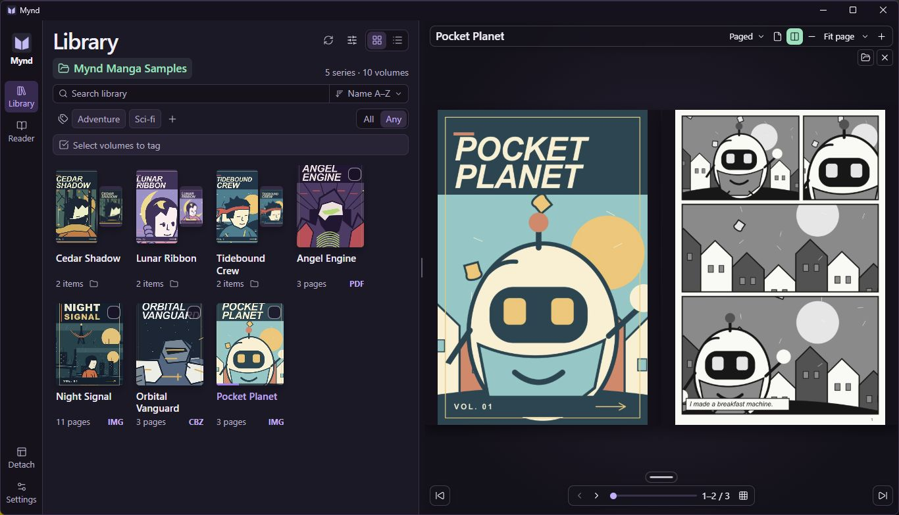
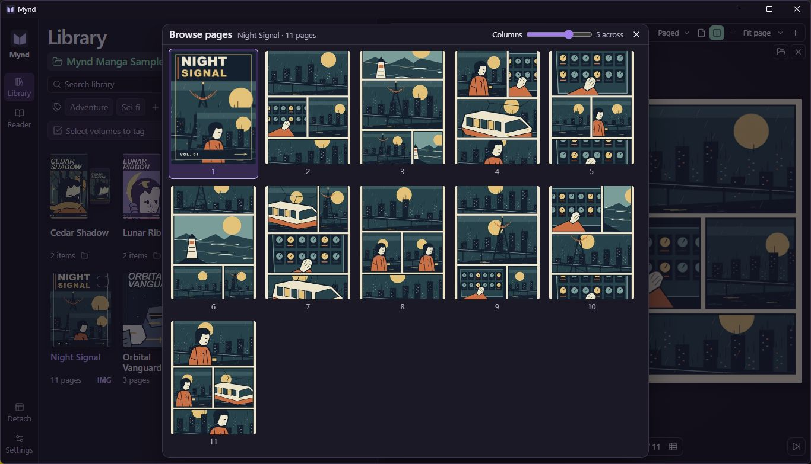
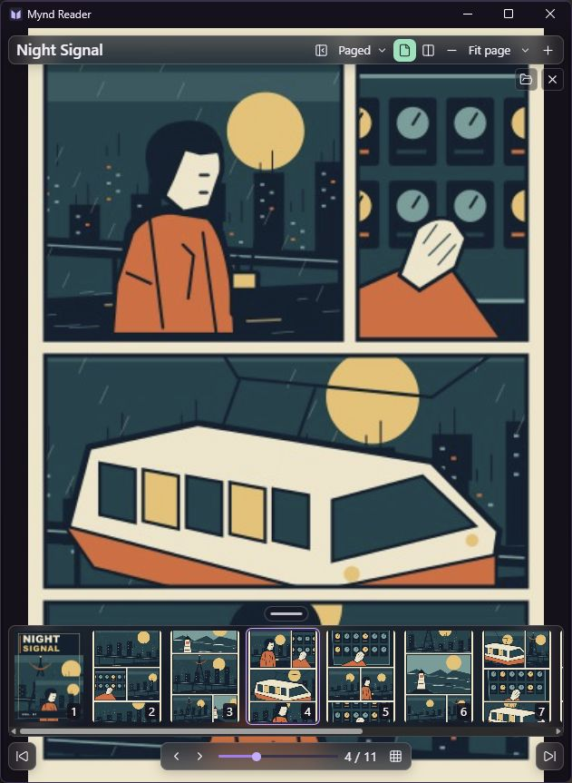

# Mynd

**Read your manga and comics offline on Windows.**

Point Mynd at the folders you already use. It turns them into a cover library, remembers your page, and lets you move the reader to a second monitor.

**[Download for Windows 11 (x64)](https://github.com/alviscmh/Mynd/releases)** · [Try the demo library](https://github.com/alviscmh/Mynd/releases/download/v0.3.0/Mynd-manga-samples.zip) · [Changelog](CHANGELOG.md)



## What you can do

- **Browse the folders you already have.** Open nested series by cover, switch to a details list, and tag several volumes at once. Filter by every selected tag or by any of them.
- **Read one page, a spread, or a continuous scroll.** Jump to a page from the filmstrip or thumbnail grid, zoom in on the art, and pick up where you left off.
- **Give the reader its own window.** Click **Detach** to move or resize it independently. Keep your library open on another monitor.

Mynd reads **CBZ**, **CBR**, **PDF**, and **folders of images** such as JPG, PNG, and WebP. Comics, tags, settings, and reading progress stay on your PC.

## Start reading

1. Download **Mynd-win-x64.zip** under **Assets** on the Releases page.
2. Right-click the ZIP, choose **Extract All**, and open **Mynd.exe** from the extracted folder.
3. Click **Add library folder**, choose your comics folder, and click a volume. To try the same artwork shown here, extract the demo ZIP and add **Mynd Manga Samples** as a library folder.

**← / →** turn pages. **Double-click** to zoom. Move the mouse over the reader to bring back its controls.

<details>
<summary>Help opening Mynd</summary>

Keep the extracted files together. Windows may show a SmartScreen prompt because the preview is unsigned. If Mynd reports that WebView2 is missing, install the x64 Evergreen Standalone Installer and reopen Mynd. [Microsoft WebView2 download](https://developer.microsoft.com/microsoft-edge/webview2/)

</details>

## Screenshots

<details>
<summary>Browse pages and read in a separate window</summary>

**Find a page by its artwork.** The page browser lays out the whole chapter in a resizable thumbnail grid.



**Move the reader to another screen.** The detached reader has its own window and keeps the filmstrip within reach.



</details>

Found something that got in the way of reading? Tell us what you were trying to do in [GitHub Issues](https://github.com/alviscmh/Mynd/issues).

<details>
<summary>For developers</summary>

Build on Windows 11 x64 from the repository folder.

```powershell
powershell -ExecutionPolicy Bypass -File .\Build.ps1 -Zip
```

The script compiles the Windows host in `src`, packages the interface in `ui`, and writes the portable folder and ZIP to `dist`. It fetches the pinned WebView2 SDK on the first run. For an offline build, pass `-WebView2SdkPath` with the extracted SDK path. The GitHub Actions workflow also builds the portable ZIP.

For startup timings, set `$env:MYND_TRACE_STARTUP = '1'` before launching Mynd. The log is in the active profile folder, usually `%LOCALAPPDATA%\Mynd`.

Dependency licenses and credits are in [Third-party notices](THIRD_PARTY_NOTICES.md).

</details>
